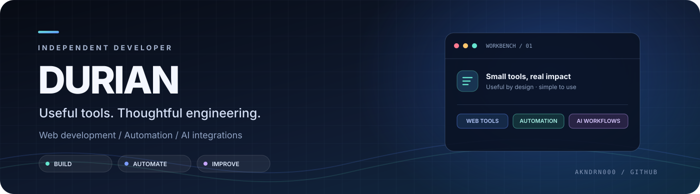
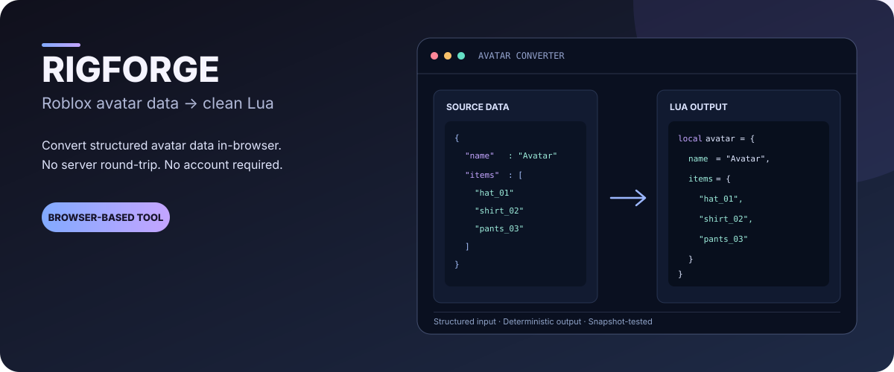
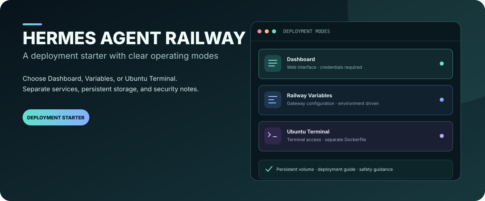
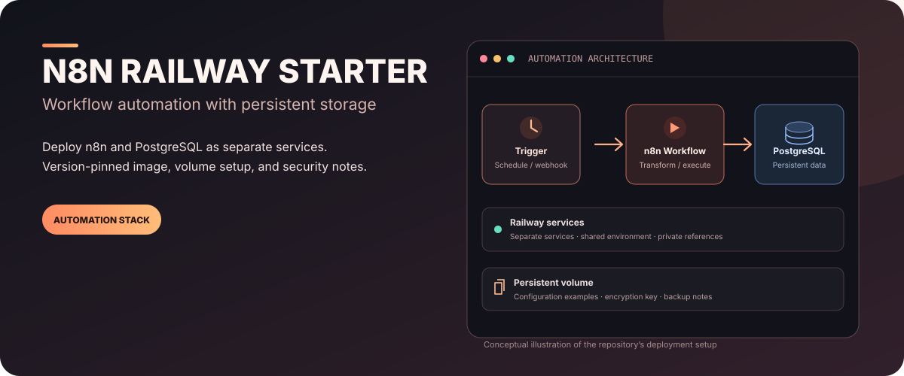
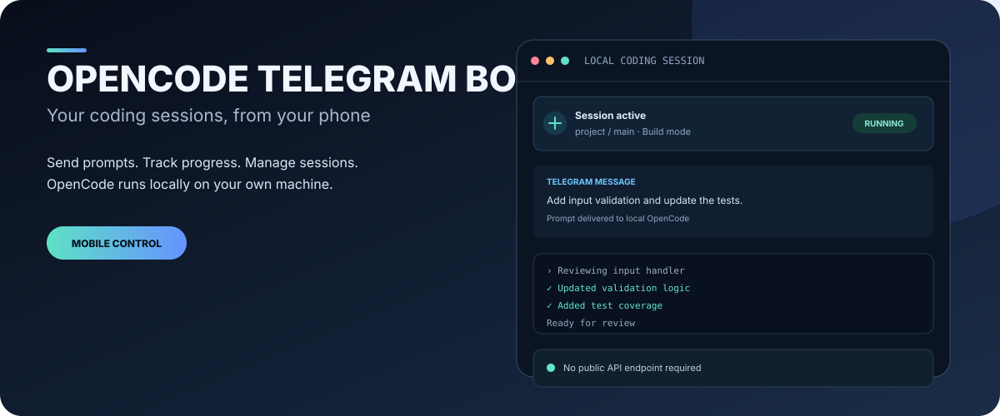

# DURIAN

**Independent Developer · Web Tools · Automation · AI Integrations**

Membangun alat digital yang praktis, alur kerja yang lebih efisien, dan integrasi AI yang berguna untuk kebutuhan nyata.

  
  
  

---

## ⭐ Koleksi Repository Favorit

Kumpulan repository open-source yang saya simpan sebagai referensi untuk membangun produk, mengeksplorasi AI, dan mengikuti perkembangan ekosistem developer. **375 repository** dikelompokkan agar lebih mudah dijelajahi.

<table>
  <tr>
    <td width="33%" valign="top">
      <strong>🤖 AI Agents & Coding Assistants</strong> 
      <a href="./starred/ai-agents.md">Jelajahi 37 repository →</a>
    </td>
    <td width="33%" valign="top">
      <strong>✨ AI Skills & Agent Skills</strong> 
      <a href="./starred/ai-skills.md">Jelajahi 59 repository →</a>
    </td>
    <td width="34%" valign="top">
      <strong>🧠 AI Tools & LLM Infrastructure</strong> 
      <a href="./starred/ai-tools.md">Jelajahi 48 repository →</a>
    </td>
  </tr>
  <tr>
    <td valign="top">
      <strong>🎬 Video, Media & Creative Tools</strong> 
      <a href="./starred/video-media.md">Jelajahi 31 repository →</a>
    </td>
    <td valign="top">
      <strong>🎨 Frontend, UI & Design</strong> 
      <a href="./starred/frontend-ui.md">Jelajahi 47 repository →</a>
    </td>
    <td valign="top">
      <strong>🏠 Self-hosted & Infrastructure</strong> 
      <a href="./starred/self-hosted.md">Jelajahi 21 repository →</a>
    </td>
  </tr>
  <tr>
    <td valign="top">
      <strong>🛠️ Developer Tools & Productivity</strong> 
      <a href="./starred/dev-tools.md">Jelajahi 32 repository →</a>
    </td>
    <td valign="top">
      <strong>📚 Learning & Education</strong> 
      <a href="./starred/learning.md">Jelajahi 7 repository →</a>
    </td>
    <td valign="top">
      <strong>📱 Mobile & Android</strong> 
      <a href="./starred/mobile.md">Jelajahi 3 repository →</a>
    </td>
  </tr>
  <tr>
    <td valign="top">
      <strong>💰 Finance & Trading</strong> 
      <a href="./starred/finance.md">Jelajahi 3 repository →</a>
    </td>
    <td valign="top">
      <strong>📦 Other / Miscellaneous</strong> 
      <a href="./starred/others.md">Jelajahi 87 repository →</a>
    </td>
    <td valign="top">
      <strong>🗂️ Semua kategori</strong> 
      <a href="./starred/">Buka direktori koleksi →</a>
    </td>
  </tr>
</table>

Setiap halaman kategori berisi tautan repository, deskripsi singkat, jumlah star, dan bahasa pemrograman jika tersedia.

---

## 👋 Tentang Saya

Saya berfokus pada pengembangan **web tools, otomasi, dan integrasi AI**. Saya menyukai proyek yang menyederhanakan pekerjaan berulang, memiliki tujuan yang jelas, dan mudah digunakan tanpa membuat prosesnya terasa rumit.

<table>
  <tr>
    <td width="50%" valign="top">
      <strong>Prinsip pengembangan</strong>  
      🎯 <strong>Purposeful</strong> — mulai dari masalah nyata, bukan sekadar menambah fitur.  
      🔒 <strong>Privacy-aware</strong> — membatasi pengumpulan data dan mengutamakan pemrosesan yang aman.  
      🧪 <strong>Testable</strong> — menjaga logika penting lewat pengujian dan validasi.  
      📘 <strong>Maintainable</strong> — dokumentasi dan instruksi penggunaan merupakan bagian dari produk.
    </td>
    <td width="50%" valign="top">
      <strong>Area yang saya eksplorasi</strong>  
      ◈ Aplikasi web yang cepat dan mudah dipahami  
      ◈ LLM, AI agents, dan integrasi API  
      ◈ Otomasi bot untuk platform komunitas  
      ◈ Tooling developer, testing, dan deployment
    </td>
  </tr>
</table>

---

## 🚀 Proyek Unggulan

<table>
  <tr>
    <td width="50%" valign="top">
      
      <h3><a href="https://github.com/DURIAN-ORGANISASI/rigforge">RigForge ↗</a></h3>
      
<strong>Browser-based Roblox avatar converter.</strong> Mengubah data avatar menjadi struktur Lua yang rapi. Satu workspace menyediakan konverter avatar dan Relay untuk konfigurasi Discord Bot secara terpisah.

      
<a href="https://rigforge-mocha.vercel.app/">Buka aplikasi</a> · <a href="https://github.com/DURIAN-ORGANISASI/rigforge">Source code</a>

      Next.js · React · TypeScript · Vitest
    </td>
    <td width="50%" valign="top">
      
      <h3><a href="https://github.com/DURIAN-ORGANISASI/hermes-railway">Hermes Agent Railway ↗</a></h3>
      
<strong>Deployment starter for Hermes Agent.</strong> Menyediakan tiga pilihan deployment—Dashboard, Railway Variables, dan Ubuntu Terminal—dengan panduan penyimpanan persisten, variabel lingkungan, dan keamanan.

      
<a href="https://github.com/DURIAN-ORGANISASI/hermes-railway">Repository &amp; deployment guide</a>

      Docker · Railway · Hermes Agent
    </td>
  </tr>
  <tr>
    <td width="50%" valign="top">
      
      <h3><a href="https://github.com/DURIAN-ORGANISASI/n8n-railway">n8n Railway Starter ↗</a></h3>
      
<strong>Self-hosted workflow automation.</strong> Starter untuk menjalankan n8n dan PostgreSQL sebagai service terpisah di Railway, dengan volume persisten, konfigurasi contoh, dan catatan keamanan.

      
<a href="https://github.com/DURIAN-ORGANISASI/n8n-railway">Repository &amp; setup guide</a>

      n8n · PostgreSQL · Docker · Railway
    </td>
    <td width="50%" valign="top">
      
      <h3><a href="https://github.com/akndrn000/opencode-telegram-bot">OpenCode Telegram Bot ↗</a></h3>
      
<strong>Remote control for AI coding sessions.</strong> Fork yang mengeksplorasi alur kerja coding jarak jauh melalui Telegram, termasuk pengelolaan sesi dan pemantauan progres, sementara OpenCode berjalan di mesin sendiri.

      
<a href="https://github.com/akndrn000/opencode-telegram-bot">Repository fork</a> · <a href="https://github.com/grinev/opencode-telegram-bot">Upstream project</a>

      Node.js · OpenCode · Telegram Bot API
    </td>
  </tr>
</table>

---

## 🧰 Technology Stack

 

<table>
  <tr>
    <td width="25%"><strong>Web development</strong></td>
    <td>React · Next.js · Vite · TypeScript · Tailwind CSS</td>
  </tr>
  <tr>
    <td><strong>Automation & APIs</strong></td>
    <td>Python · Discord API · Telegram Bot · API integrations</td>
  </tr>
  <tr>
    <td><strong>AI tooling</strong></td>
    <td>LLM integrations · AI agents · Groq · Gemini · OpenAI-compatible APIs</td>
  </tr>
  <tr>
    <td><strong>Quality & delivery</strong></td>
    <td>Vitest · Pytest · ESLint · Ruff · Docker · Vercel · Railway · GitHub Actions</td>
  </tr>
</table>

---

## 📈 GitHub Activity

  
  

---

## 🤝 Terhubung

Terbuka untuk diskusi teknis, masukan, dan kolaborasi pada proyek open-source.

Dibangun dengan rasa ingin tahu, perhatian pada detail, dan iterasi berkelanjutan.

