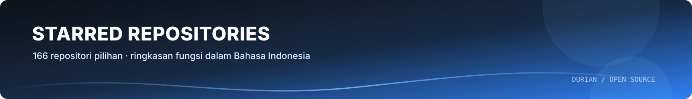
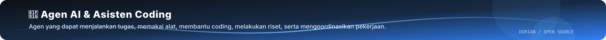
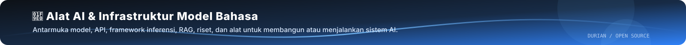
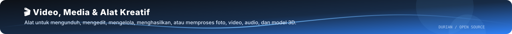
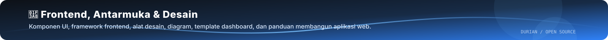
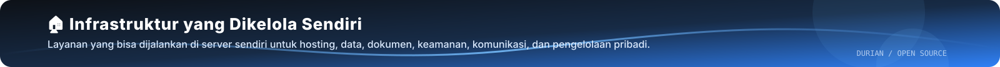
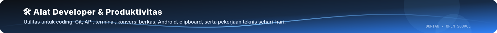
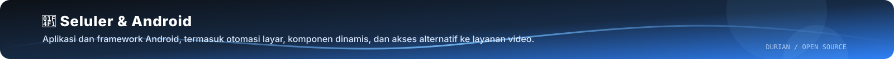

### Web Developer · Automation & AI Tooling

 

 

## 👋 Tentang Saya

<table>
<tr>
<td width="62%" valign="top">

Saya developer yang fokus pada **alat web praktis** dan **otomasi**. Proyek saya berangkat dari kebutuhan nyata: mengonversi data, membuat metadata massal dengan bantuan AI, sampai menjalankan agen AI di Telegram dan Discord.

**Prinsip kerja**

- 🎯 **Fokus.** Satu alat untuk satu masalah, dengan antarmuka yang jelas.
- 🔒 **Privasi dulu.** Proses berjalan di browser pengguna, tanpa server perantara dan tanpa pelacak.
- ✅ **Teruji.** Logika inti dilindungi tes otomatis dan didokumentasikan dengan rapi.
- 🚢 **Siap rilis.** Setiap proyek punya panduan deploy yang bisa langsung diikuti.

</td>
<td width="38%" valign="top" align="center">

</td>
</tr>
</table>

 

## 🧰 Tech Stack

 

 

| Bidang | Teknologi |
| :-- | :-- |
| **Frontend** | React 19 · Next.js 16 (App Router) · Vite · Tailwind CSS v4 · TypeScript (strict) |
| **Backend & Otomasi** | Next.js API Routes · Python · Discord REST API · Telegram Bot |
| **AI & Integrasi** | Groq · Gemini · Hermes Agent · OpenAI-compatible endpoint |
| **DevOps** | Docker · Vercel · Railway · Git |
| **Kualitas** | Vitest · Pytest · ESLint · Ruff · Snapshot testing |

 

## 🚀 Proyek Unggulan

<table>
<tr>
<td width="50%" align="center" valign="top">

### [StockMeta](https://github.com/akndrn000/stockmeta)

**Metadata AI untuk Adobe Stock & Shutterstock.** Unggah hingga 20 foto per batch, hasilkan judul, kata kunci, dan kategori, lalu ekspor CSV sesuai format resmi.

🔗 [Buka demo](https://stockmeta-one.vercel.app)

</td>
<td width="50%" align="center" valign="top">

### [RigForge](https://github.com/akndrn000/rigforge)

**Konverter data avatar Roblox ke Lua.** Berjalan sepenuhnya di browser, tanpa server dan tanpa login. Dilindungi 26 kasus uji snapshot.

🔗 [Buka demo](https://rigforge-lemon.vercel.app)

</td>
</tr>
<tr>
<td width="50%" align="center" valign="top">

### [Relay](https://github.com/akndrn000/relay)

**Pengirim pesan Discord lewat Bot resmi.** Terkunci ke satu channel tujuan, token tidak disimpan di server, sesuai Ketentuan Layanan Discord.

🔗 [Buka demo](https://relay-eosin-five.vercel.app)

</td>
<td width="50%" align="center" valign="top">

### [My Hermes Agent](https://github.com/akndrn000/my-hermes-agent)

**Bot AI pribadi di Telegram dan Discord.** Konfigurasi deploy siap pakai berbasis Docker dan Railway, lengkap dengan panduan keamanan dan troubleshooting.

🔗 [Lihat repositori](https://github.com/akndrn000/my-hermes-agent)

</td>
</tr>
</table>

 

## 📊 Aktivitas

 

## 📌 Fokus Saat Ini

| 🔭 Sedang dipelajari | 🛠️ Sedang dikerjakan | 🤝 Terbuka untuk |
| :-- | :-- | :-- |
| Next.js 16 dan React 19 | Alat web berbasis AI | Kolaborasi proyek open source |
| Integrasi LLM ke alur kerja | Otomasi bot dan deployment | Diskusi teknis dan masukan |
| Pengujian otomatis | Dokumentasi yang rapi | Proyek web berskala kecil |

 

---

# ⭐ Starred Repositories

**166 repositori open source · 10 kategori**

Koleksi repositori open-source yang saya simpan sebagai referensi. **Nama repo ditampilkan sebagai emblem yang bisa diklik** untuk membuka sumber aslinya. Deskripsi di bawah menjelaskan fungsi praktis setiap proyek dalam Bahasa Indonesia.

## 🧭 Navigasi kategori

- [🤖 Agen AI & Asisten Coding (22)](#ai-agents-coding-assistants)
- [✨ Skill AI & Keterampilan Agen (28)](#ai-skills-agent-skills)
- [🧠 Alat AI & Infrastruktur Model Bahasa (16)](#ai-tools-llm-infrastructure)
- [🎬 Video, Media & Alat Kreatif (17)](#video-media-creative-tools)
- [🎨 Frontend, Antarmuka & Desain (23)](#frontend-ui-design)
- [🏠 Infrastruktur yang Dikelola Sendiri (14)](#self-hosted-infrastructure)
- [🛠️ Alat Developer & Produktivitas (21)](#developer-tools-productivity)
- [📚 Belajar & Edukasi (7)](#learning-education)
- [📱 Seluler & Android (3)](#mobile-android)
- [📦 Lainnya, Katalog & Proyek Tambahan (15)](#other-awesome-lists-misc)

> ⭐ Jumlah bintang dan bahasa pemrograman mengikuti data saat daftar dibuat, jadi dapat berubah. Deskripsi Indonesia adalah ringkasan fungsi berdasarkan informasi yang tersedia pada repositori; untuk detail teknis terbaru, buka dokumentasi resminya.

---

## 🤖 Agen AI & Asisten Coding

Agen yang dapat menjalankan tugas, memakai alat, membantu coding, melakukan riset, serta mengoordinasikan pekerjaan.

 **[openclaw/openclaw](https://github.com/openclaw/openclaw)**  
Bahasa: TypeScript  
Agen AI serbaguna yang dapat menjalankan tugas lintas sistem operasi dan platform, bukan sekadar menjawab pertanyaan.

---

 **[obra/superpowers](https://github.com/obra/superpowers)**  
Bahasa: Shell  
Kerangka kerja skill untuk agen coding yang memberi alur kerja terstruktur—mulai dari merencanakan, menguji, hingga menyelesaikan fitur.

---

 **[affaan-m/ECC](https://github.com/affaan-m/ECC)**  
Bahasa: JavaScript  
Paket optimasi agen coding yang berisi skill, aturan keamanan, memori, dan pola pengembangan berbasis riset untuk berbagai alat coding AI.

---

 **[msitarzewski/agency-agents](https://github.com/msitarzewski/agency-agents)**  
Bahasa: Shell  
Kumpulan agen AI dengan peran khusus untuk pekerjaan seperti pengembangan frontend, pemasaran, riset komunitas, dan pelaksanaan proyek.

---

 **[farion1231/cc-switch](https://github.com/farion1231/cc-switch)**  
Bahasa: Rust  
Aplikasi desktop untuk mengelola dan berpindah konfigurasi berbagai asisten coding AI dari satu tempat.

---

 **[browser-use/browser-use](https://github.com/browser-use/browser-use)**  
Bahasa: Python  
Pustaka Python agar agen AI dapat membuka situs, menelusuri halaman, dan berinteraksi dengan browser untuk menyelesaikan tugas web.

---

 **[thedotmack/claude-mem](https://github.com/thedotmack/claude-mem)**  
Bahasa: TypeScript  
Sistem memori lintas sesi yang menyimpan, meringkas, dan memasukkan kembali konteks kerja agar agen AI tidak kehilangan riwayat penting.

---

 **[OpenHands/OpenHands](https://github.com/OpenHands/OpenHands)**  
Bahasa: TypeScript  
Platform pengembangan berbantuan AI untuk membantu menulis kode, menggunakan alat, dan menjalankan tugas rekayasa perangkat lunak.

---

 **[pbakaus/impeccable](https://github.com/pbakaus/impeccable)**  
Bahasa: Rust  
Panduan bahasa desain dan aturan UI untuk membantu agen coding menghasilkan antarmuka yang lebih konsisten dan berkualitas.

---

 **[colbymchenry/codegraph](https://github.com/colbymchenry/codegraph)**  
Bahasa: C  
Membuat graf pengetahuan lokal dari basis kode dan menyinkronkannya saat kode berubah, sehingga agen lebih cepat memahami hubungan antarfile.

---

 **[usestrix/strix](https://github.com/usestrix/strix)**  
Bahasa: Python  
Alat pengujian keamanan berbantuan AI untuk menemukan kerentanan aplikasi dan membantu proses perbaikan.

---

 **[aaif-goose/goose](https://github.com/aaif-goose/goose)**  
Bahasa: Rust  
Agen AI open-source yang dapat memasang alat, menjalankan perintah, mengedit berkas, dan menguji hasil menggunakan berbagai model bahasa.

---

 **[vectorize-io/hindsight](https://github.com/vectorize-io/hindsight)**  
Bahasa: Python  
Sistem memori untuk agen AI yang menyimpan pengalaman lalu memperbaiki cara mengingat dan menggunakan informasi pada tugas berikutnya.

---

 **[OpenBMB/ChatDev](https://github.com/OpenBMB/ChatDev)**  
Bahasa: Python  
Kerangka kerja kolaborasi multi-agen untuk membagi proses pengembangan perangkat lunak ke beberapa peran AI.

---

 **[mksglu/context-mode](https://github.com/mksglu/context-mode)**  
Bahasa: TypeScript  
Mengurangi keluaran alat yang masuk ke konteks agen coding, menyimpan memori sesi, dan mengatur perutean alat untuk menghemat token.

---

 **[promptfoo/promptfoo](https://github.com/promptfoo/promptfoo)**  
Bahasa: TypeScript  
Alat untuk menguji, membandingkan, dan mengaudit prompt maupun agen AI, termasuk pengujian red-team dan pemindaian risiko.

---

 **[hypit-ai/hypit](https://github.com/hypit-ai/hypit)**  
Bahasa: TypeScript  
Otomasi berbasis agen AI untuk membuat banyak variasi video dari sebuah referensi, termasuk mengganti elemen visual dan teks.

---

 **[earthtojake/text-to-cad](https://github.com/earthtojake/text-to-cad)**  
Bahasa: Python  
Mengubah instruksi teks menjadi rancangan CAD melalui agen AI untuk membantu membuat model objek teknis.

---

 **[mvschwarz/openrig](https://github.com/mvschwarz/openrig)**  
Bahasa: TypeScript  
Kerangka kerja untuk menjalankan tim agen AI dengan peran, konteks bersama, dan pembagian pekerjaan yang menetap.

---

 **[Kiln-AI/Kiln](https://github.com/Kiln-AI/Kiln)**  
Bahasa: Python  
Perangkat untuk membangun dan mengevaluasi sistem AI, termasuk dataset, RAG, fine-tuning, agen, dan pengujian model.

---

 **[melgarafael/DeskcommCRM](https://github.com/melgarafael/DeskcommCRM)**  
Bahasa: TypeScript  
CRM yang dapat di-host sendiri dengan agen AI dan integrasi WhatsApp untuk mengelola percakapan penjualan serta pelanggan.

---

 **[androoAGI/starnet](https://github.com/androoAGI/starnet)**  
Bahasa: JavaScript  
Aplikasi desktop bergaya pixel-art untuk menjalankan dan memantau agen AI yang benar-benar mengerjakan tugas secara lokal.

---

[↑ Kembali ke navigasi kategori](#-navigasi-kategori)

---

## ✨ Skill AI & Keterampilan Agen

Instruksi dan alur kerja siap pakai untuk menambah kemampuan agen AI, mulai dari coding dan desain sampai riset serta penulisan.

 **[mattpocock/skills](https://github.com/mattpocock/skills)**  
Bahasa: Shell  
Kumpulan skill praktis untuk agen coding, berfokus pada kebiasaan rekayasa perangkat lunak yang digunakan pengembang berpengalaman.

---

 **[anthropics/skills](https://github.com/anthropics/skills)**  
Bahasa: Python  
Kumpulan contoh dan definisi Agent Skills untuk memperluas kemampuan asisten AI melalui instruksi dan alur kerja khusus.

---

 **[DietrichGebert/ponytail](https://github.com/DietrichGebert/ponytail)**  
Bahasa: JavaScript  
Skill untuk membuat agen coding bekerja lebih hemat: menghindari perubahan yang tidak perlu dan memilih solusi paling sederhana.

---

 **[nextlevelbuilder/ui-ux-pro-max-skill](https://github.com/nextlevelbuilder/ui-ux-pro-max-skill)**  
Bahasa: Python  
Skill desain UI/UX yang memberi panduan visual dan praktik antarmuka profesional untuk berbagai platform.

---

 **[Graphify-Labs/graphify](https://github.com/Graphify-Labs/graphify)**  
Bahasa: Python  
Memetakan kode, dokumentasi, skema SQL, konfigurasi, dan PDF menjadi knowledge graph yang dapat ditelusuri agen AI secara lokal.

---

 **[JuliusBrussee/caveman](https://github.com/JuliusBrussee/caveman)**  
Bahasa: Go  
Skill dan proxy yang mempersingkat gaya komunikasi agen coding agar pemakaian token lebih rendah.

---

 **[addyosmani/agent-skills](https://github.com/addyosmani/agent-skills)**  
Bahasa: JavaScript  
Kumpulan skill rekayasa perangkat lunak untuk membantu agen coding mengikuti praktik kerja yang siap digunakan di proyek nyata.

---

 **[Leonxlnx/taste-skill](https://github.com/Leonxlnx/taste-skill)**  
Bahasa: JavaScript  
Skill yang memberi arahan art direction, referensi visual, serta pemeriksaan di browser agar UI buatan AI tidak terlihat generik.

---

 **[Egonex-AI/Understand-Anything](https://github.com/Egonex-AI/Understand-Anything)**  
Bahasa: TypeScript  
Mengubah kode menjadi graf interaktif supaya struktur, hubungan, dan alur sebuah codebase lebih mudah dijelajahi dan ditanyakan ke AI.

---

 **[tt-a1i/archify](https://github.com/tt-a1i/archify)**  
Bahasa: JavaScript  
Skill untuk mengubah ide, rencana, atau codebase menjadi diagram interaktif agar arsitektur lebih mudah dijelaskan.

---

 **[ComposioHQ/awesome-claude-skills](https://github.com/ComposioHQ/awesome-claude-skills)**  
Bahasa: Python  
Daftar pilihan skill, sumber, dan alat untuk menyesuaikan alur kerja Claude dengan kebutuhan tertentu.

---

 **[blader/humanizer](https://github.com/blader/humanizer)**  
Bahasa: Python  
Skill penyuntingan teks untuk mengurangi ciri tulisan yang terasa generik atau dibuat otomatis oleh AI.

---

 **[coreyhaines31/marketingskills](https://github.com/coreyhaines31/marketingskills)**  
Bahasa: JavaScript  
Skill AI untuk pemasaran digital, mencakup optimasi konversi, SEO, analitik, dan strategi pertumbuhan.

---

 **[Imbad0202/academic-research-skills](https://github.com/Imbad0202/academic-research-skills)**  
Bahasa: Python  
Skill untuk alur riset akademik dari pencarian bahan hingga penulisan, peninjauan, revisi, dan finalisasi naskah.

---

 **[MadsLorentzen/ai-job-search](https://github.com/MadsLorentzen/ai-job-search)**  
Bahasa: Python  
Kerangka kerja lokal untuk mencari pekerjaan, menilai lowongan, menyesuaikan CV, membuat surat lamaran, dan berlatih wawancara.

---

 **[wshobson/agents](https://github.com/wshobson/agents)**  
Bahasa: Python  
Kumpulan plugin dan agen spesialis yang dapat dipakai lintas alat coding AI untuk memperluas tugas yang dapat diotomatisasi.

---

 **[virgiliojr94/book-to-skill](https://github.com/virgiliojr94/book-to-skill)**  
Bahasa: Python  
Mengubah PDF buku teknis menjadi skill Claude Code agar isinya bisa dijadikan panduan kerja yang mudah dipanggil saat coding.

---

 **[nidhinjs/prompt-master](https://github.com/nidhinjs/prompt-master)**  
Bahasa: -  
Skill untuk menyusun prompt yang lebih tepat bagi berbagai alat AI dengan menjaga konteks dan memori percakapan.

---

 **[wheresryan22/anatomy](https://github.com/wheresryan22/anatomy)**  
Bahasa: JavaScript  
Skill untuk membuat ilustrasi isometrik interaktif tentang mesin atau sistem nyata dalam bentuk SVG, dengan opsi efek WebGL.

---

 **[krillinai/OpenCreator](https://github.com/krillinai/OpenCreator)**  
Bahasa: TypeScript  
Ruang kerja AI bagi kreator untuk mengunduh, menerjemahkan, dan membuat video, gambar, suara, avatar, serta hasil edit.

---

 **[zenstory-ai/oh-story-claudecode](https://github.com/zenstory-ai/oh-story-claudecode)**  
Bahasa: Python  
Kumpulan skill untuk membantu menulis novel web berbahasa Mandarin, dari analisis referensi hingga penyuntingan dan desain sampul.

---

 **[miqdadbadjuber/anti-slop](https://github.com/miqdadbadjuber/anti-slop)**  
Bahasa: JavaScript  
Aturan untuk membantu agen coding menghindari desain UI, teks, dan kode yang terasa generik atau asal dibuat AI.

---

 **[WorldFlowAI/everything-claude-code](https://github.com/WorldFlowAI/everything-claude-code)**  
Bahasa: JavaScript  
Toolkit Claude Code berisi agen, perintah, skill, aturan, dan hook untuk menyusun alur pengembangan yang lebih produktif.

---

 **[sergebulaev/linkedin-skills](https://github.com/sergebulaev/linkedin-skills)**  
Bahasa: Python  
Skill untuk menulis posting dan komentar LinkedIn, menganalisis linimasa, serta mengatur jadwal publikasi konten.

---

 **[nateherkai/scroll-craft](https://github.com/nateherkai/scroll-craft)**  
Bahasa: JavaScript  
Skill untuk membuat situs dengan animasi dan pengalaman visual berbasis gulir yang imersif.

---

 **[kaankiziltug/logo-design-skill](https://github.com/kaankiziltug/logo-design-skill)**  
Bahasa: HTML  
Panduan dan skill desain logo yang mencakup prinsip desain, proses, pembuatan SVG, alat uji, dan koleksi referensi logo.

---

 **[superdesigndev/superdesign-skill](https://github.com/superdesigndev/superdesign-skill)**  
Bahasa: JavaScript  
Skill desain frontend untuk membantu agen AI membuat antarmuka yang lebih matang, konsisten, dan layak diproduksikan.

---

 **[bahayonghang/academic-writing-skills](https://github.com/bahayonghang/academic-writing-skills)**  
Bahasa: Python  
Toolkit untuk memeriksa format, tata bahasa, gaya, referensi, dan kualitas tulisan akademik yang sudah ada.

---

[↑ Kembali ke navigasi kategori](#-navigasi-kategori)

---

## 🧠 Alat AI & Infrastruktur Model Bahasa

Antarmuka model, API, framework inferensi, RAG, riset, dan alat untuk membangun atau menjalankan sistem AI.

 **[AUTOMATIC1111/stable-diffusion-webui](https://github.com/AUTOMATIC1111/stable-diffusion-webui)**  
Bahasa: Python  
Antarmuka web untuk menjalankan dan mengatur pembuatan gambar dengan model Stable Diffusion.

---

 **[open-webui/open-webui](https://github.com/open-webui/open-webui)**  
Bahasa: Python  
Antarmuka AI yang dapat di-host sendiri untuk menggunakan model lokal seperti Ollama atau API model yang kompatibel dengan OpenAI.

---

 **[headroomlabs-ai/headroom](https://github.com/headroomlabs-ai/headroom)**  
Bahasa: Python  
Mengompres keluaran alat, log, berkas, dan potongan RAG sebelum masuk ke model AI agar penggunaan token lebih hemat.

---

 **[jingyaogong/minimind](https://github.com/jingyaogong/minimind)**  
Bahasa: Python  
Proyek edukasi untuk melatih model bahasa kecil dari awal dengan kode dan proses yang dapat dipelajari.

---

 **[khoj-ai/khoj](https://github.com/khoj-ai/khoj)**  
Bahasa: Python  
Asisten pengetahuan pribadi yang dapat di-host sendiri untuk mencari jawaban dari web dan dokumen, melakukan riset, serta menjalankan otomasi.

---

 **[sgl-project/sglang](https://github.com/sgl-project/sglang)**  
Bahasa: Python  
Framework untuk menyajikan model bahasa besar dan model multimodal dengan kinerja tinggi.

---

 **[tashfeenahmed/freellmapi](https://github.com/tashfeenahmed/freellmapi)**  
Bahasa: TypeScript  
Satu endpoint API bergaya OpenAI yang merutekan permintaan ke banyak penyedia model gratis dengan pengalihan otomatis jika gagal.

---

 **[NandhaKishorM/laya](https://github.com/NandhaKishorM/laya)**  
Bahasa: Python  
Mesin keputusan AI ringan untuk memilih opsi, memberi skor, atau menjawab ya/tidak dari teks dalam banyak bahasa.

---

 **[assafelovic/gpt-researcher](https://github.com/assafelovic/gpt-researcher)**  
Bahasa: Python  
Agen riset otonom yang mengumpulkan dan menyusun informasi dari berbagai sumber menggunakan model AI yang dipilih.

---

 **[fastai/fastai](https://github.com/fastai/fastai)**  
Bahasa: Jupyter Notebook  
Pustaka deep learning Python beserta materi pembelajaran untuk membangun model AI dengan praktik yang terstruktur.

---

 **[nashsu/llm_wiki](https://github.com/nashsu/llm_wiki)**  
Bahasa: TypeScript  
Aplikasi desktop yang mengubah dokumen menjadi wiki pribadi saling terhubung dan memperbaruinya secara bertahap dengan bantuan LLM.

---

 **[Ebony-Vinyl/dsh-our-free-model](https://github.com/Ebony-Vinyl/dsh-our-free-model)**  
Bahasa: JavaScript  
Plugin untuk memakai model AI tertentu di DSH tanpa akun atau API key, sesuai ketentuan dan batas layanan proyek.

---

 **[AsyncFuncAI/deepwiki-open](https://github.com/AsyncFuncAI/deepwiki-open)**  
Bahasa: Python  
Pembuat wiki otomatis berbantuan AI dari repositori GitHub, GitLab, atau Bitbucket untuk memahami struktur proyek.

---

 **[Wan-Video/Wan2.2](https://github.com/Wan-Video/Wan2.2)**  
Bahasa: Python  
Model generatif video skala besar yang dapat digunakan untuk eksperimen dan pembuatan video berbasis AI.

---

 **[microsoft/data-formulator](https://github.com/microsoft/data-formulator)**  
Bahasa: Python  
Aplikasi interaktif untuk menghubungkan data, mengeksplorasi isinya, dan membuat visualisasi dengan bantuan AI.

---

 **[567-labs/instructor](https://github.com/567-labs/instructor)**  
Bahasa: Python  
Pustaka untuk meminta keluaran LLM dalam struktur data yang tervalidasi, misalnya objek dengan skema tertentu.

---

[↑ Kembali ke navigasi kategori](#-navigasi-kategori)

---

## 🎬 Video, Media & Alat Kreatif

Alat untuk mengunduh, mengedit, mengelola, menghasilkan, atau memproses foto, video, audio, dan model 3D.

 **[yt-dlp/yt-dlp](https://github.com/yt-dlp/yt-dlp)**  
Bahasa: Python  
Alat baris perintah untuk mengunduh audio dan video dari banyak situs yang didukung.

---

 **[immich-app/immich](https://github.com/immich-app/immich)**  
Bahasa: TypeScript  
Server foto dan video yang dapat di-host sendiri untuk menyimpan, mengatur, dan menelusuri koleksi media pribadi.

---

 **[nexu-io/open-design](https://github.com/nexu-io/open-design)**  
Bahasa: TypeScript  
Ruang kerja kolaboratif berbantuan agen AI untuk membuat prototipe, situs, aplikasi, dashboard, presentasi, gambar, dan video.

---

 **[OpenCut-app/OpenCut](https://github.com/OpenCut-app/OpenCut)**  
Bahasa: TypeScript  
Editor video open-source sebagai alternatif CapCut untuk mengedit konten video.

---

 **[debpalash/VoiceStudio](https://github.com/debpalash/VoiceStudio)**  
Bahasa: Python  
Studio suara lokal untuk kloning suara, desain suara, dubbing video, dikte, transkripsi, dan pembuatan audiobook.

---

 **[heygen-com/hyperframes](https://github.com/heygen-com/hyperframes)**  
Bahasa: TypeScript  
Alat untuk membuat video dengan menulis HTML lalu merendernya, cocok untuk alur kerja video yang diotomatisasi agen.

---

 **[remotion-dev/remotion](https://github.com/remotion-dev/remotion)**  
Bahasa: TypeScript  
Framework React untuk menyusun dan merender video secara programatis dari komponen dan kode.

---

 **[jellyfin/jellyfin](https://github.com/jellyfin/jellyfin)**  
Bahasa: C#  
Server media gratis untuk mengelola dan menayangkan koleksi video, musik, serta media pribadi ke berbagai perangkat.

---

 **[upscayl/upscayl](https://github.com/upscayl/upscayl)**  
Bahasa: TypeScript  
Aplikasi gratis berbasis AI untuk memperbesar resolusi gambar di Linux, macOS, dan Windows.

---

 **[danielgatis/rembg](https://github.com/danielgatis/rembg)**  
Bahasa: Python  
Alat untuk menghapus latar belakang dari gambar secara otomatis.

---

 **[CapSoftware/Cap](https://github.com/CapSoftware/Cap)**  
Bahasa: Rust  
Perekam layar open-source untuk membuat rekaman layar yang mudah dibagikan.

---

 **[ahmedkhaleel2004/gitdiagram](https://github.com/ahmedkhaleel2004/gitdiagram)**  
Bahasa: TypeScript  
Membuat diagram arsitektur interaktif dan video penjelasan singkat dari repositori GitHub.

---

 **[img2threejs/img2threejs](https://github.com/img2threejs/img2threejs)**  
Bahasa: Python  
Membangun model 3D berbasis kode Three.js dari gambar referensi, dengan pemeriksaan kualitas dan dukungan animasi.

---

 **[spotbye/SpotiFLAC](https://github.com/spotbye/SpotiFLAC)**  
Bahasa: TypeScript  
Alat untuk memperoleh trek musik dalam format FLAC dari layanan sumber yang didukung; periksa legalitas dan ketentuan layanan terkait.

---

 **[averygan/reclip](https://github.com/averygan/reclip)**  
Bahasa: HTML  
Pengunduh media yang dapat di-host sendiri dengan antarmuka web untuk mengambil video dari banyak situs.

---

 **[OpenWhispr/openwhispr](https://github.com/OpenWhispr/openwhispr)**  
Bahasa: JavaScript  
Aplikasi dikte suara ke teks lintas platform yang mendukung model lokal atau cloud dan berfokus pada privasi.

---

 **[timoncool/YuE2-Studio](https://github.com/timoncool/YuE2-Studio)**  
Bahasa: TypeScript  
Aplikasi Windows lokal untuk membuat lagu dengan AI, termasuk vokal, partitur yang dapat diedit, dan pemutaran ulang.

---

[↑ Kembali ke navigasi kategori](#-navigasi-kategori)

---

## 🎨 Frontend, Antarmuka & Desain

Komponen UI, framework frontend, alat desain, diagram, template dashboard, dan panduan membangun aplikasi web.

 **[codecrafters-io/build-your-own-x](https://github.com/codecrafters-io/build-your-own-x)**  
Bahasa: Markdown  
Kumpulan panduan belajar pemrograman dengan membangun ulang teknologi populer dari dasar.

---

 **[nilbuild/developer-roadmap](https://github.com/nilbuild/developer-roadmap)**  
Bahasa: TypeScript  
Peta jalan interaktif dan panduan belajar untuk membantu pengembang merencanakan peningkatan keterampilan karier.

---

 **[n8n-io/n8n](https://github.com/n8n-io/n8n)**  
Bahasa: TypeScript  
Platform otomasi workflow visual yang dapat menghubungkan layanan, API, kode khusus, dan komponen AI.

---

 **[firecrawl/firecrawl](https://github.com/firecrawl/firecrawl)**  
Bahasa: TypeScript  
API untuk mengambil dan mengubah konten web menjadi data yang siap dipakai agen AI atau pipeline pengolahan data.

---

 **[excalidraw/excalidraw](https://github.com/excalidraw/excalidraw)**  
Bahasa: TypeScript  
Papan tulis digital untuk menggambar diagram bergaya sketsa dengan mudah.

---

 **[shadcn-ui/ui](https://github.com/shadcn-ui/ui)**  
Bahasa: TypeScript  
Kumpulan komponen antarmuka yang dapat disalin dan dikustomisasi untuk membangun UI web yang aksesibel.

---

 **[louislam/uptime-kuma](https://github.com/louislam/uptime-kuma)**  
Bahasa: JavaScript  
Dashboard pemantauan layanan yang di-host sendiri untuk mengecek uptime dan memberi peringatan saat layanan bermasalah.

---

 **[jesseduffield/lazygit](https://github.com/jesseduffield/lazygit)**  
Bahasa: Go  
Antarmuka terminal interaktif untuk menjalankan operasi Git tanpa harus menghafal banyak perintah.

---

 **[abi/screenshot-to-code](https://github.com/abi/screenshot-to-code)**  
Bahasa: Python  
Mengubah tangkapan layar desain menjadi kode antarmuka seperti HTML, Tailwind, React, atau Vue.

---

 **[rohitg00/ai-engineering-from-scratch](https://github.com/rohitg00/ai-engineering-from-scratch)**  
Bahasa: Python  
Materi belajar rekayasa AI melalui praktik membangun proyek dari dasar hingga siap digunakan.

---

 **[reactive-resume/reactive-resume](https://github.com/reactive-resume/reactive-resume)**  
Bahasa: TypeScript  
Pembuat CV open-source yang gratis, dapat dikustomisasi, dan berfokus pada privasi data pengguna.

---

 **[Crosstalk-Solutions/project-nomad](https://github.com/Crosstalk-Solutions/project-nomad)**  
Bahasa: TypeScript  
Server pengetahuan dan edukasi offline berisi Wikipedia, buku, kursus, peta, serta opsi AI lokal.

---

 **[AvaloniaUI/Avalonia](https://github.com/AvaloniaUI/Avalonia)**  
Bahasa: C#  
Framework UI berbasis C# dan XAML untuk membangun aplikasi desktop, mobile, embedded, dan WebAssembly.

---

 **[monkeytypegame/monkeytype](https://github.com/monkeytypegame/monkeytype)**  
Bahasa: TypeScript  
Situs latihan mengetik dengan banyak mode dan opsi kustomisasi untuk mengukur serta meningkatkan kecepatan mengetik.

---

 **[Effect-TS/effect](https://github.com/Effect-TS/effect)**  
Bahasa: TypeScript  
Ekosistem TypeScript untuk membangun aplikasi yang terstruktur dengan penanganan efek, error, dan konkurensi.

---

 **[satnaing/shadcn-admin](https://github.com/satnaing/shadcn-admin)**  
Bahasa: TypeScript  
Template dashboard administrasi yang dibuat dengan shadcn/ui dan Vite.

---

 **[lnkiai/m3e-canvas](https://github.com/lnkiai/m3e-canvas)**  
Bahasa: TypeScript  
Kanvas berbasis browser untuk merancang layar Material 3 Expressive lalu mengubahnya menjadi prompt coding.

---

 **[zumerlab/snapdom](https://github.com/zumerlab/snapdom)**  
Bahasa: JavaScript  
Mesin untuk mengambil, memodifikasi, dan mengonversi elemen DOM menjadi keluaran seperti gambar atau format lain.

---

 **[kaifcodec/user-scanner](https://github.com/kaifcodec/user-scanner)**  
Bahasa: Python  
Perangkat OSINT untuk mencari jejak digital dari alamat email atau nama pengguna melalui banyak sumber dan integrasi MCP.

---

 **[dembrandt/dembrandt](https://github.com/dembrandt/dembrandt)**  
Bahasa: TypeScript  
Mengekstrak sistem desain sebuah situs—logo, warna, tipografi, dan border—menjadi token yang bisa dipakai ulang.

---

 **[bergside/typeui](https://github.com/bergside/typeui)**  
Bahasa: TypeScript  
Perangkat untuk membantu membangun antarmuka pengguna yang lebih baik dengan dukungan AI.

---

 **[neobrutalism/neobrutalism](https://github.com/neobrutalism/neobrutalism)**  
Bahasa: TypeScript  
Pustaka komponen React dan Tailwind bergaya neo-brutalism untuk membangun UI yang tegas dan kontras.

---

 **[SehajveerSingh2005/bloom](https://github.com/SehajveerSingh2005/bloom)**  
Bahasa: TypeScript  
Aplikasi pendamping desktop Windows dengan pengalaman workspace yang lebih fleksibel dan responsif.

---

[↑ Kembali ke navigasi kategori](#-navigasi-kategori)

---

## 🏠 Infrastruktur yang Dikelola Sendiri

Layanan yang bisa dijalankan di server sendiri untuk hosting, data, dokumen, keamanan, komunikasi, dan pengelolaan pribadi.

 **[freeCodeCamp/freeCodeCamp](https://github.com/freeCodeCamp/freeCodeCamp)**  
Bahasa: TypeScript  
Kurikulum dan platform open-source untuk belajar matematika, pemrograman, serta ilmu komputer secara gratis.

---

 **[ossu/computer-science](https://github.com/ossu/computer-science)**  
Bahasa: HTML  
Kurikulum mandiri ilmu komputer yang disusun dari materi dan mata kuliah gratis.

---

 **[caddyserver/caddy](https://github.com/caddyserver/caddy)**  
Bahasa: Go  
Server web lintas platform dengan dukungan HTTPS otomatis dan konfigurasi yang fleksibel.

---

 **[toeverything/AFFiNE](https://github.com/toeverything/AFFiNE)**  
Bahasa: TypeScript  
Workspace pengetahuan dan produktivitas yang menggabungkan catatan, papan visual, perencanaan, dan pembuatan konten.

---

 **[dani-garcia/vaultwarden](https://github.com/dani-garcia/vaultwarden)**  
Bahasa: Rust  
Server kompatibel Bitwarden yang ringan untuk mengelola pengelola kata sandi secara mandiri.

---

 **[pocketbase/pocketbase](https://github.com/pocketbase/pocketbase)**  
Bahasa: Go  
Backend ringkas dalam satu berkas dengan database real-time, autentikasi, penyimpanan, dan API bawaan.

---

 **[paperless-ngx/paperless-ngx](https://github.com/paperless-ngx/paperless-ngx)**  
Bahasa: Python  
Sistem pengelolaan dokumen digital untuk memindai, mengindeks, mencari, dan mengarsipkan berkas.

---

 **[HeyPuter/puter](https://github.com/HeyPuter/puter)**  
Bahasa: TypeScript  
Lingkungan komputasi web open-source yang dapat di-host sendiri untuk mengakses aplikasi dan berkas melalui browser.

---

 **[chatwoot/chatwoot](https://github.com/chatwoot/chatwoot)**  
Bahasa: Ruby  
Platform layanan pelanggan multi-kanal untuk live chat, email, dan pengelolaan percakapan dukungan.

---

 **[glanceapp/glance](https://github.com/glanceapp/glance)**  
Bahasa: Go  
Dashboard mandiri untuk mengumpulkan berbagai feed dan sumber informasi ke dalam satu tampilan.

---

 **[dgtlmoon/changedetection.io](https://github.com/dgtlmoon/changedetection.io)**  
Bahasa: Python  
Pemantau perubahan halaman web untuk mendeteksi pembaruan konten, penurunan harga, stok kembali, atau perubahan tak diinginkan.

---

 **[actualbudget/actual](https://github.com/actualbudget/actual)**  
Bahasa: TypeScript  
Aplikasi pengelolaan keuangan pribadi yang mengutamakan penyimpanan lokal dan penganggaran.

---

 **[we-promise/sure](https://github.com/we-promise/sure)**  
Bahasa: Ruby  
Aplikasi keuangan pribadi untuk mencatat dan memantau kondisi keuangan secara mandiri.

---

 **[openbao/openbao](https://github.com/openbao/openbao)**  
Bahasa: Go  
Sistem untuk menyimpan, mengelola, dan mendistribusikan rahasia, sertifikat, serta kunci dengan aman.

---

[↑ Kembali ke navigasi kategori](#-navigasi-kategori)

---

## 🛠️ Alat Developer & Produktivitas

Utilitas untuk coding, Git, API, terminal, konversi berkas, Android, clipboard, serta pekerjaan teknis sehari-hari.

 **[microsoft/markitdown](https://github.com/microsoft/markitdown)**  
Bahasa: Python  
Alat Python untuk mengonversi dokumen dan berkas Office ke format Markdown agar mudah diproses atau dianalisis AI.

---

 **[Genymobile/scrcpy](https://github.com/Genymobile/scrcpy)**  
Bahasa: C  
Menampilkan layar perangkat Android di komputer sekaligus mengontrolnya melalui mouse dan keyboard.

---

 **[localsend/localsend](https://github.com/localsend/localsend)**  
Bahasa: Dart  
Aplikasi berbagi berkas lintas platform di jaringan lokal sebagai alternatif AirDrop.

---

 **[astral-sh/uv](https://github.com/astral-sh/uv)**  
Bahasa: Rust  
Manajer paket dan proyek Python yang sangat cepat untuk mengelola dependensi serta lingkungan kerja.

---

 **[hoppscotch/hoppscotch](https://github.com/hoppscotch/hoppscotch)**  
Bahasa: TypeScript  
Alat pengembangan dan pengujian API lintas web, desktop, dan CLI, sebagai alternatif Postman atau Insomnia.

---

 **[ventoy/Ventoy](https://github.com/ventoy/Ventoy)**  
Bahasa: C  
Alat untuk membuat USB bootable yang dapat menyimpan banyak berkas ISO tanpa perlu memformat ulang untuk setiap ISO.

---

 **[termux/termux-app](https://github.com/termux/termux-app)**  
Bahasa: Java  
Terminal Android yang dapat diperluas dengan paket Linux untuk menjalankan alat pengembangan langsung di ponsel.

---

 **[tw93/Pake](https://github.com/tw93/Pake)**  
Bahasa: Rust  
Mengemas situs web menjadi aplikasi desktop yang ringan dan cepat.

---

 **[sharkdp/bat](https://github.com/sharkdp/bat)**  
Bahasa: Rust  
Pengganti perintah `cat` dengan pewarnaan sintaks dan tampilan berkas yang lebih nyaman.

---

 **[usebruno/bruno](https://github.com/usebruno/bruno)**  
Bahasa: JavaScript  
Aplikasi untuk menjelajah, mengirim, dan menguji permintaan API secara lokal sebagai alternatif Postman.

---

 **[cli/cli](https://github.com/cli/cli)**  
Bahasa: Go  
CLI resmi GitHub untuk mengelola repositori, issue, pull request, dan aktivitas GitHub dari terminal.

---

 **[CorentinTh/it-tools](https://github.com/CorentinTh/it-tools)**  
Bahasa: Vue  
Kumpulan utilitas web untuk pekerjaan developer, seperti konversi, encoding, dan pemeriksaan data.

---

 **[gchq/CyberChef](https://github.com/gchq/CyberChef)**  
Bahasa: JavaScript  
Toolkit web untuk mengubah, mengodekan, mendekodekan, mengompres, dan menganalisis data.

---

 **[qarmin/czkawka](https://github.com/qarmin/czkawka)**  
Bahasa: Fluent  
Aplikasi untuk menemukan berkas duplikat, folder kosong, gambar serupa, dan berkas yang tidak diperlukan.

---

 **[cjpais/Handy](https://github.com/cjpais/Handy)**  
Bahasa: Rust  
Aplikasi open-source untuk mengubah ucapan menjadi teks sepenuhnya offline.

---

 **[DevToys-app/DevToys](https://github.com/DevToys-app/DevToys)**  
Bahasa: C#  
Kumpulan utilitas desktop bagi developer, seperti konverter, encoder, formatter, dan pembuat hash.

---

 **[cmderdev/cmder](https://github.com/cmderdev/cmder)**  
Bahasa: PowerShell  
Paket emulator terminal Windows dengan lingkungan baris perintah yang lebih nyaman dan portabel.

---

 **[yorukot/superfile](https://github.com/yorukot/superfile)**  
Bahasa: Go  
Pengelola berkas modern di terminal untuk menavigasi folder dan mengatur berkas dengan cepat.

---

 **[brunodev85/winlator](https://github.com/brunodev85/winlator)**  
Bahasa: C  
Aplikasi Android untuk menjalankan sebagian aplikasi Windows melalui lapisan kompatibilitas Wine dan Box86/Box64.

---

 **[hluk/CopyQ](https://github.com/hluk/CopyQ)**  
Bahasa: C++  
Pengelola clipboard dengan riwayat dan fitur lanjutan untuk menyimpan serta menggunakan ulang salinan teks atau data.

---

 **[git-bug/git-bug](https://github.com/git-bug/git-bug)**  
Bahasa: Go  
Pelacak bug terdistribusi yang terintegrasi dengan Git dan dapat digunakan secara offline.

---

[↑ Kembali ke navigasi kategori](#-navigasi-kategori)

---

## 📚 Belajar & Edukasi

Kurikulum, buku, tutorial, katalog API, dan materi untuk belajar pemrograman, desain sistem, atau layanan self-hosted.

 **[public-apis/public-apis](https://github.com/public-apis/public-apis)**  
Bahasa: Python  
Direktori API publik yang dapat digunakan untuk belajar, membuat prototipe, dan mengintegrasikan layanan.

---

 **[EbookFoundation/free-programming-books](https://github.com/EbookFoundation/free-programming-books)**  
Bahasa: Python  
Kumpulan buku pemrograman gratis yang dapat diakses untuk belajar berbagai bahasa dan topik teknis.

---

 **[donnemartin/system-design-primer](https://github.com/donnemartin/system-design-primer)**  
Bahasa: Python  
Panduan mempelajari desain sistem berskala besar, dilengkapi konsep inti dan kartu belajar Anki.

---

 **[awesome-selfhosted/awesome-selfhosted](https://github.com/awesome-selfhosted/awesome-selfhosted)**  
Bahasa: -  
Katalog perangkat lunak gratis dan layanan jaringan yang dapat dijalankan di server sendiri.

---

 **[practical-tutorials/project-based-learning](https://github.com/practical-tutorials/project-based-learning)**  
Bahasa: Python  
Daftar tutorial berbasis proyek untuk mempelajari pemrograman melalui pembuatan aplikasi nyata.

---

 **[ripienaar/free-for-dev](https://github.com/ripienaar/free-for-dev)**  
Bahasa: HTML  
Daftar layanan SaaS, PaaS, dan IaaS yang menyediakan paket gratis yang relevan bagi developer.

---

 **[THU-MAIC/OpenMAIC](https://github.com/THU-MAIC/OpenMAIC)**  
Bahasa: TypeScript  
Kelas interaktif berbasis beberapa agen AI untuk menghadirkan pengalaman belajar yang lebih imersif.

---

[↑ Kembali ke navigasi kategori](#-navigasi-kategori)

---

## 📱 Seluler & Android

Aplikasi dan framework Android, termasuk otomasi layar, komponen dinamis, dan akses alternatif ke layanan video.

 **[gkd-kit/gkd](https://github.com/gkd-kit/gkd)**  
Bahasa: Kotlin  
Aplikasi Android untuk mengotomatisasi ketukan layar berdasarkan aturan, selector aksesibilitas, dan langganan konfigurasi.

---

 **[alibaba/atlas](https://github.com/alibaba/atlas)**  
Bahasa: Java  
Framework Android untuk memuat dan mengelola komponen aplikasi secara dinamis.

---

 **[InfinityLoop1308/PipePipe](https://github.com/InfinityLoop1308/PipePipe)**  
Bahasa: Shell  
Aplikasi Android open-source untuk menjelajahi YouTube dan layanan video lain melalui antarmuka alternatif.

---

[↑ Kembali ke navigasi kategori](#-navigasi-kategori)

---

## 📦 Lainnya, Katalog & Proyek Tambahan

Proyek lintas kategori seperti rekayasa balik, pengelolaan agen, pengindeksan dokumen, scraping, dan utilitas berkas.

 **[morluto/rea](https://github.com/morluto/rea)**  
Bahasa: TypeScript  
Alat rekayasa balik berbantuan agen untuk memahami perilaku aplikasi hingga komponen biner native.

---

 **[github/spec-kit](https://github.com/github/spec-kit)**  
Bahasa: Python  
Toolkit untuk memulai pengembangan perangkat lunak berbasis spesifikasi, sehingga kebutuhan ditulis sebelum implementasi.

---

 **[paperclipai/paperclip](https://github.com/paperclipai/paperclip)**  
Bahasa: TypeScript  
Aplikasi open-source untuk mengatur pekerjaan, koordinasi, dan pengelolaan agen AI dalam sebuah tim.

---

 **[stablyai/orca](https://github.com/stablyai/orca)**  
Bahasa: TypeScript  
Lingkungan untuk menjalankan banyak agen coding secara paralel menggunakan langganan AI sendiri di desktop, ponsel, atau runtime jarak jauh.

---

 **[omacom/omarchy](https://github.com/omacom/omarchy)**  
Bahasa: Shell  
Konfigurasi Linux yang sudah dirancang dengan tampilan modern dan pilihan bawaan yang opiniated.

---

 **[VectifyAI/PageIndex](https://github.com/VectifyAI/PageIndex)**  
Bahasa: Python  
Pendekatan pengindeksan dokumen untuk RAG yang mengandalkan struktur dokumen dan penalaran, bukan basis data vektor.

---

 **[block/buzz](https://github.com/block/buzz)**  
Bahasa: Rust  
Platform komunikasi berbasis konsep hive mind untuk menghubungkan percakapan dan kolaborasi.

---

 **[ScrapeGraphAI/Scrapegraph-ai](https://github.com/ScrapeGraphAI/Scrapegraph-ai)**  
Bahasa: Python  
Pustaka scraping Python yang memanfaatkan AI untuk mengekstrak informasi dari situs web.

---

 **[NVIDIA/OpenShell](https://github.com/NVIDIA/OpenShell)**  
Bahasa: Rust  
Runtime yang berfokus pada privasi dan keamanan untuk menjalankan agen AI otonom.

---

 **[VERT-sh/VERT](https://github.com/VERT-sh/VERT)**  
Bahasa: TypeScript  
Konverter berkas open-source yang memproses berkas secara lokal, tanpa biaya, dan tanpa perlu mengunggahnya ke server.

---

 **[megadose/holehe](https://github.com/megadose/holehe)**  
Bahasa: Python  
Alat OSINT untuk memeriksa apakah alamat email terdaftar pada berbagai situs melalui mekanisme pemulihan akun.

---

 **[jo-inc/camofox-browser](https://github.com/jo-inc/camofox-browser)**  
Bahasa: JavaScript  
Browser headless untuk agen AI yang dirancang menghadapi sistem deteksi bot dan dapat dipakai sebagai pengganti Puppeteer/Playwright.

---

 **[braedonsaunders/codeflow](https://github.com/braedonsaunders/codeflow)**  
Bahasa: HTML  
Peta arsitektur interaktif dari URL GitHub untuk melihat hubungan antarfile dan memahami dampak perubahan kode.

---

 **[atria-asi/Atria-Dawn](https://github.com/atria-asi/Atria-Dawn)**  
Bahasa: -  
Deskripsi sumber belum tersedia; buka repositori untuk memeriksa tujuan, fitur, dan petunjuk penggunaan resminya.

---

 **[LuxAlgo/trade-journal](https://github.com/LuxAlgo/trade-journal)**  
Bahasa: TypeScript  
Jurnal trading yang dapat di-host sendiri dengan sinkronisasi broker, kalender untung-rugi, analitik, dan refleksi berbantuan AI.

---

[↑ Kembali ke navigasi kategori](#-navigasi-kategori)

---

**166 repositori · 10 kategori**

[⬆ Kembali ke atas](#-starred-repositories) · [Buka STARRED.md versi ringkas](https://github.com/akndrn000/akndrn000/blob/main/STARRED.md)

## 📫 Terhubung

Punya ide, masukan, atau ingin berkolaborasi? Silakan buka *issue* atau *pull request* di repositori saya.

